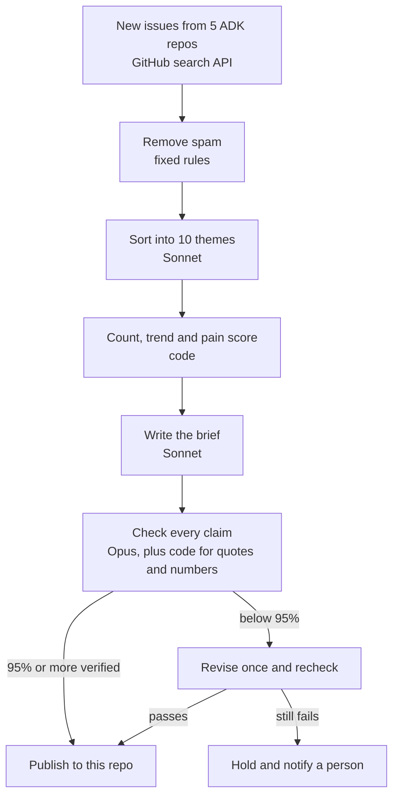
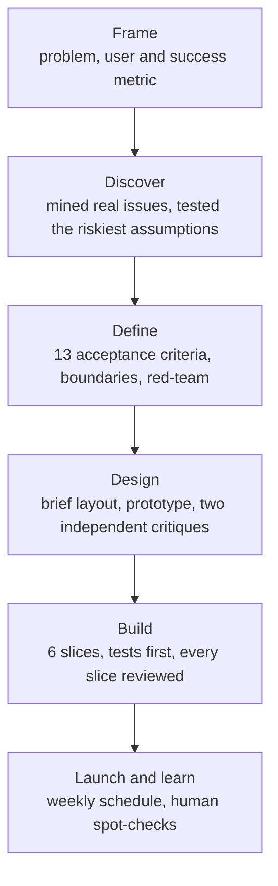

# ADK: Automated Voice-of-Customer Analysis

Google's Agent Development Kit gets sixty to ninety new GitHub issues every week, spread across five repos. Somewhere in that pile is the bug that will cost a team a week, the security report nobody has looked at yet, and the regression that shipped with Tuesday's release.

A PM has three ways to keep up today. You can read every issue, which doesn't scale. You can watch a dashboard of labels, which misses anything nobody labeled. Or you can ask an AI to summarize, which sounds confident and is sometimes wrong.

This project reads every new issue so you don't have to. Each Monday it publishes a short brief that ranks the week's biggest pain points, flags anything risky, and links every claim to the issue it came from. A second AI checks every claim before anything goes out. If the brief doesn't pass, it doesn't publish.

**Not affiliated with Google.** Read only: this project never posts, comments or labels on ADK repos.

## Briefs
Each week is named by its Monday. The brief publishes the following Monday.

<!-- index:start -->
| Week | Issues | Status | Top theme |
|---|---|---|---|
| [2026-10-05](briefs/2026-10-05.md) | 83 | Published, 98% verified | Sessions, state and memory |
| [2026-09-28](briefs/2026-09-28.md) | 59 | Published, 98% verified | Docs, CI and dev setup |
<!-- index:end -->

## Why you can trust it
Every line in a brief links to the public issue it came from, so you can check any claim in one click. The brief is written by one model and checked by another. Sonnet writes, and Opus reads every claim in a separate run and has to quote the evidence it found. Anything code can verify, code verifies. Counts, trends and pain scores are recomputed, and every quote is matched word for word. If fewer than 95% of claims hold up, the brief gets one revision. If it still falls short, it is held and a person is told why. Red flags are open issues that report a security problem, data loss, a repeated side effect or a disabled safety gate, and they are presented as reports, not verdicts. For the first four briefs, a person also checks five random claims against their sources.

Found a wrong claim? Open an issue in this repo.

## How it works

Pain = issues × severity weight × repos affected × (1 + median comments ÷ 10). It ranks themes within a week.
Issue text is untrusted, so the AI runs with no tools, connectors or settings.

## How it was built
Built end to end with an AI-native product workflow: each stage produces a written artifact and ends at a human go/no-go gate.


- **Riskiest assumptions first.** Before any code, AI sorting agreed with hand labels on 97% of real issues, and the checker judged 10 of 10 claims correctly, including 2 deliberately false ones.
- **Evals with a holdout.** The classifier scores 97 to 100% on the dev set and 9 of 9 on fresh issues it never saw, beating keyword rules by at least 5 points.
- **Two reviewers per change.** Every slice was reviewed by a second model. The four high-risk slices (public content, publishing, the unattended run, guardrails) were also approved by a person.
- **An independent spec check.** A separate agent tried to break every requirement and found two leaks (personal data and exploit wording). Both were fixed before launch.
- **152 tests** run on every commit.

<details>
<summary>Run it yourself</summary>

Requires Python 3.11+, git, curl and a logged-in Claude Code CLI (`claude`).
```
python3 -m pip install -r requirements.txt
git config core.hooksPath .githooks
python3 run.py --week 2026-10-05            # writes data/2026-10-05/ (local only)
python3 run.py --week 2026-10-05 --publish  # also commits briefs/2026-10-05.md if the gate passes
./check.sh                                  # lint + offline tests
python3 evals/run.py                        # evals (calls claude -p)
python3 spotcheck.py --week 2026-10-05      # 5 random claims to check by hand
```

**Weekly schedule (macOS).** A launchd job runs `run_weekly.sh` on Monday at 09:00, at login and every hour. It only works when a week is due, so the hourly calls catch up after sleep. Each run ends with a row in `data/runs.csv` (pass, hold or error). Holds and errors show a notification.

macOS blocks background jobs under `~/Documents`, so the job runs from a separate clone:
```
git clone https://github.com/BishopSlice/adk-voc.git ~/adk-voc
sed "s|APP_DIR|$HOME/adk-voc|" ~/adk-voc/launchd/com.vicky.adkvoc.plist > ~/Library/LaunchAgents/com.vicky.adkvoc.plist
launchctl bootstrap gui/$(id -u) ~/Library/LaunchAgents/com.vicky.adkvoc.plist
launchctl print gui/$(id -u)/com.vicky.adkvoc | grep "last exit"   # expect 0
```
The clone runs `git pull` before each run, so pushed changes reach the next run. Only the latest full week is caught up. Run an older week by hand: `./run_weekly.sh 2026-10-12`.

**Human steps.**
- Changed themes, weights or repos? Runs hold until you approve: `python3 gate.py approve-config --by <name>`.
- Spot-check disagreed? Publishing holds until the checker prompt is fixed: `python3 spotcheck.py --week <W> --checker-fixed "<what changed>"`.
</details>
